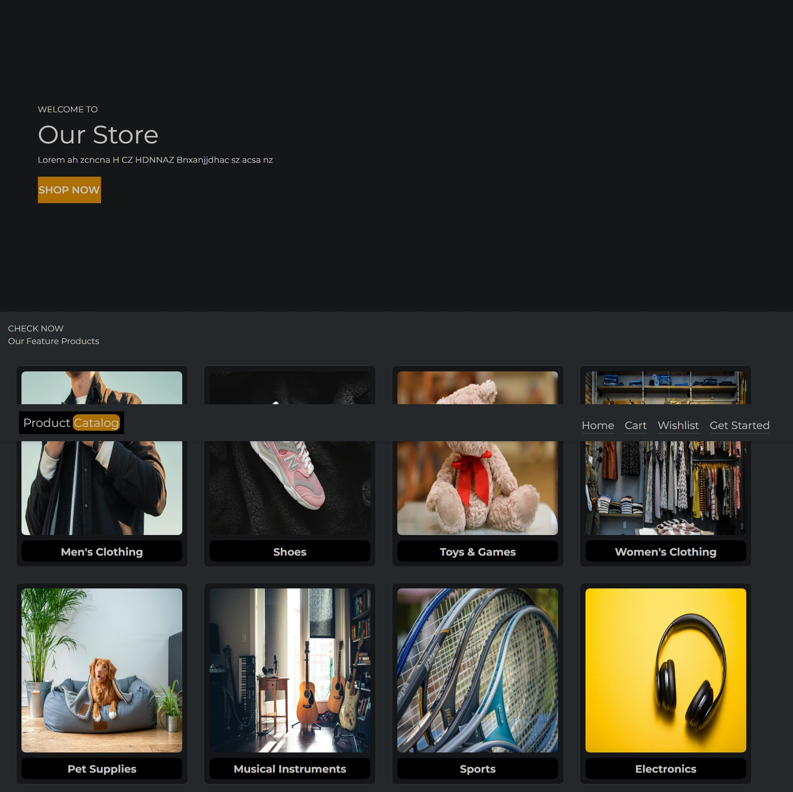
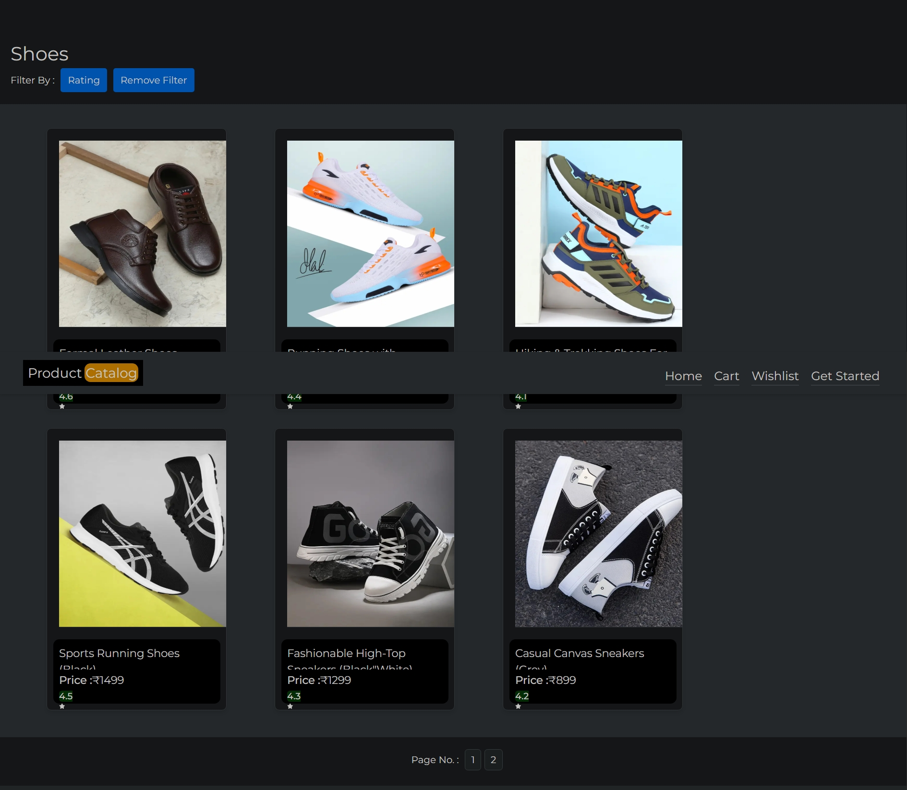
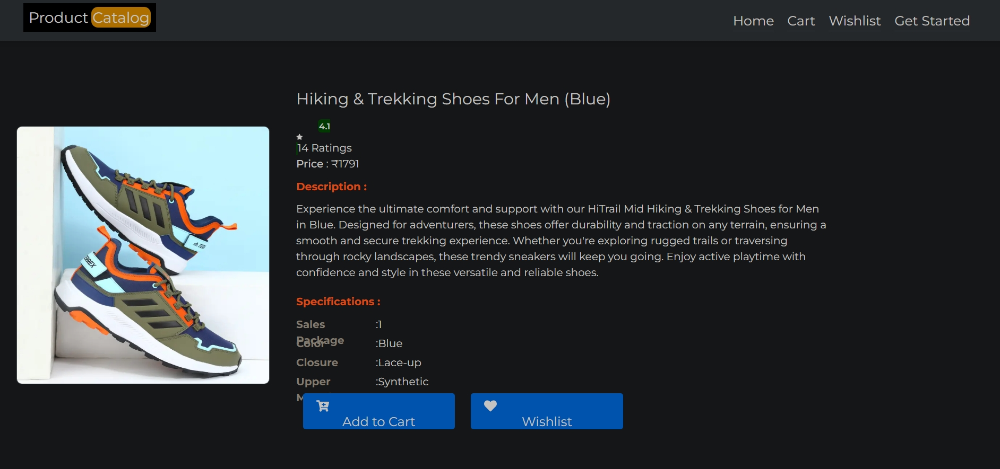

# 🛒 Shopping-site — E-Commerce Web Application

<div align="center">

**A full-stack MERN e-commerce web application with user authentication, product browsing, cart, wishlist, and user profiles.**

<br />

[](https://developer.mozilla.org/en-US/docs/Web/JavaScript)
[](https://react.dev/)
[](https://reactrouter.com/)
[](https://react-icons.github.io/react-icons/)
[](https://lucide.dev/)
[](https://react-hot-toast.com/)
[](https://tailwindcss.com/)
[](https://axios-http.com/)
[](https://nodejs.org/)
[](https://expressjs.com/)
[](https://www.mongodb.com/)
[](https://mongoosejs.com/)
[](https://jwt.io/)
[](https://github.com/kelektiv/node.bcrypt.js)
[](https://cloudinary.com/)
[](https://nodemailer.com/)
[](https://github.com/expressjs/multer)
[](https://express-validator.github.io/)

Also used: body-parser, cookie-parser, cors, dotenv, randomstring, mongoose-unique-validator.

</div>

---

## Overview


A React single-page app on a Node/Express API with MongoDB Atlas. The frontend talks to the API over REST routes. Authentication uses JWT sessions stored in httpOnly cookies, passwords are bcrypt-hashed, password reset works through an OTP sent by email, and profile photos are uploaded via multer to Cloudinary.

```text
React SPA (views · components · react-router)
        ↓
Axios → Express REST API
        ↓
Auth (JWT · bcrypt · OTP email reset) · Data (MongoDB Atlas · Cloudinary)
        ↓
Users, profiles, feedback
```

---

## ✨ Features

### User authentication

Registration and login issue a JWT into an httpOnly cookie. Passwords are stored bcrypt-hashed, and protected routes verify the token on each request.

```text
POST /signup { name, email, password }
  → bcrypt.hash(password, 10) → user saved
  → jwt.sign({ email, name }, secret, { expiresIn: '1h' })
  → httpOnly cookie set

POST /login { email, password }
  → bcrypt.compare(...) → cookie refreshed
```

The cookie is httpOnly, so it is not accessible from client-side JavaScript.

### OTP password reset

```text
POST /sendOTP { email }      → 6-digit OTP emailed via Nodemailer
POST /verifyOTP { vOTP }      → verified
PUT  /changePassword { ... } → new password bcrypt-hashed and saved
```

### Product catalog

Category pages listing products by category, with product detail views. Product images are hosted on Cloudinary.

### Dynamic product sorting

Any category page sorts by price or customer rating — toggleable, descending — with 6-per-page pagination.

### Cart and wishlist

Product, cart, and wishlist views for browsing and saving items.

### Profiles and feedback

Authenticated users have a profile with a photo upload, and can submit feedback. Users, profiles, and feedback are stored as Mongoose models on MongoDB Atlas.

---

## 🖼️ Screenshots

### 1. Home — product catalog



### 2. Category — sort by price and rating



### 3. Product page



---

## 🧠 Architecture


```text
                 ┌──────────────────┐
                 │ Client — React   │
                 │ SPA              │
                 │ views · compo-   │
                 │ nents · router   │
                 └────────┬─────────┘
                          │ axios, JWT cookie
                          ▼
                 ┌──────────────────┐
                 │   Express API    │
                 │ /signup · /login │
                 │ /sendOTP ·       │
                 │ /verifyOTP ·     │
                 │ /changePassword  │
                 └────────┬─────────┘
                          │
            ┌─────────────┼─────────────┐
            ▼             ▼             ▼
     ┌────────────┐ ┌──────────┐ ┌────────────┐
     │ Auth       │ │  Uploads │ │   Data     │
     │ JWT verify │ │ multer + │ │ Mongoose   │
     │ bcrypt     │ │ Cloudin- │ │ Atlas:     │
     │ OTP email  │ │ ary      │ │ user ·     │
     │ validation │ │ (profile │ │ profile ·  │
     │            │ │ photos)  │ │ feedback   │
     └────────────┘ └──────────┘ └────────────┘
```

**Request flow:** every protected route passes through `IsAuthorized` (JWT verify) before reaching a controller. Auth inputs are validated with express-validator. The OTP reset runs in three steps (`/sendOTP` → `/verifyOTP` → `/changePassword`). Profile photos go through multer (type and size filtered) to Cloudinary, and the URL is saved on the profile.

---

## 📁 Project Structure

```text
Shopping-site/
├── server/
│   ├── app.js                 # Express app, routes, MongoDB connect
│   ├── controllers/           # user-controller, changePassword (OTP), profilePage
│   ├── middlewares/           # isAuthorized (JWT), multer+Cloudinary, nodemailer
│   ├── models/                # user, profile, feedback
│   └── package.json
├── src/
│   ├── views/                 # home, category, product, cart, wishlist
│   ├── components/            # Auth (login/register/password), navbar, footer
│   ├── data.jsx               # static catalog (Cloudinary image URLs)
│   ├── App.js                 # routing
│   └── Base_url.js            # API base URL
├── public/
├── package.json
└── tailwind.config.js
```

---

## 🛠️ Run it

```bash
# frontend
npm install
npm start

# backend (new terminal)
cd server
npm install
# create server/.env with your own values (never commit it):
# MONGODB_URI, JWT secrets, email credentials, Cloudinary keys
node app.js
```

---

## 👤 Author

**Yash Raj Gupta**
B.Tech Mechanical Engineering (2024–2028), IIT (BHU) Varanasi

- GitHub: [@YashRajGupta-1](https://github.com/YashRajGupta-1)
